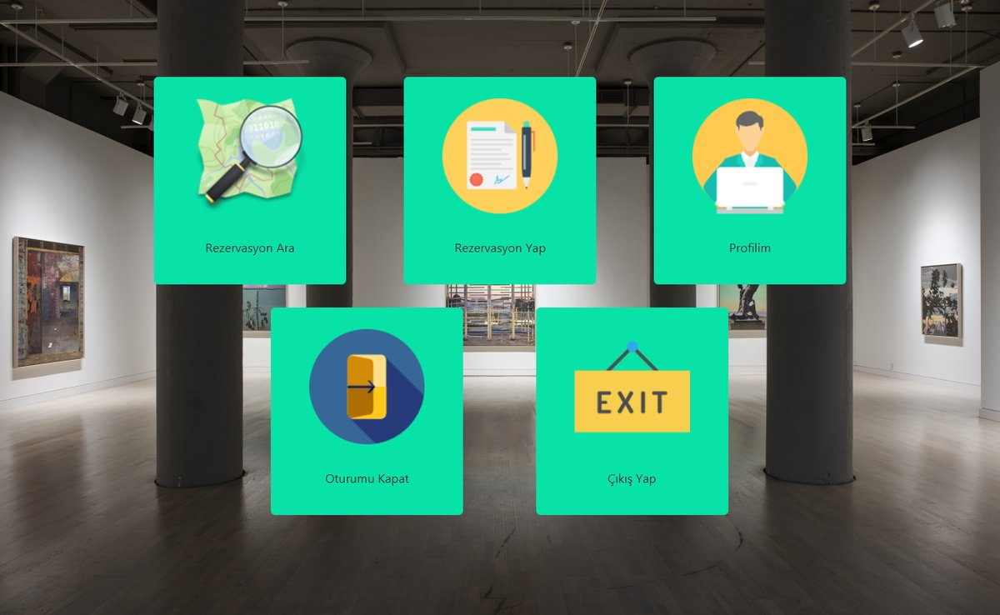
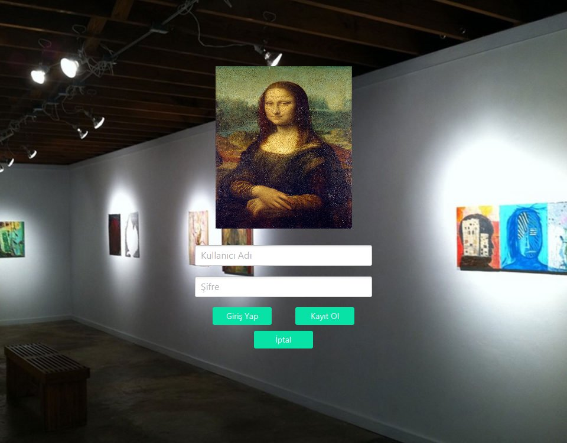
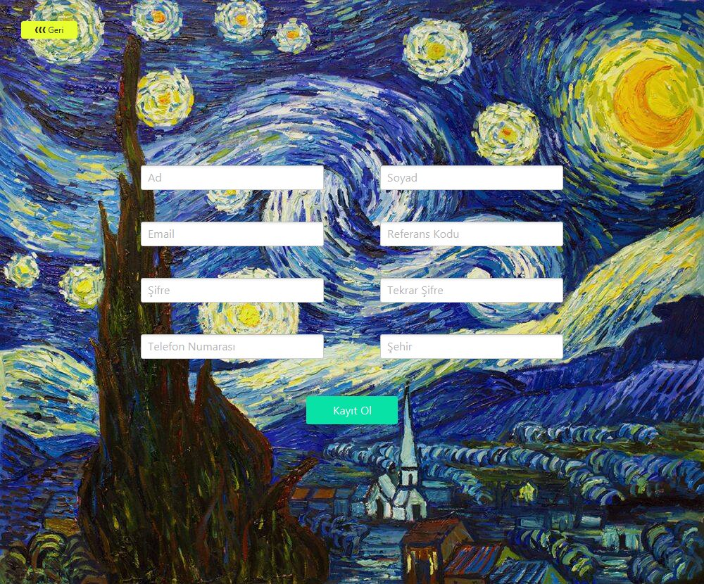
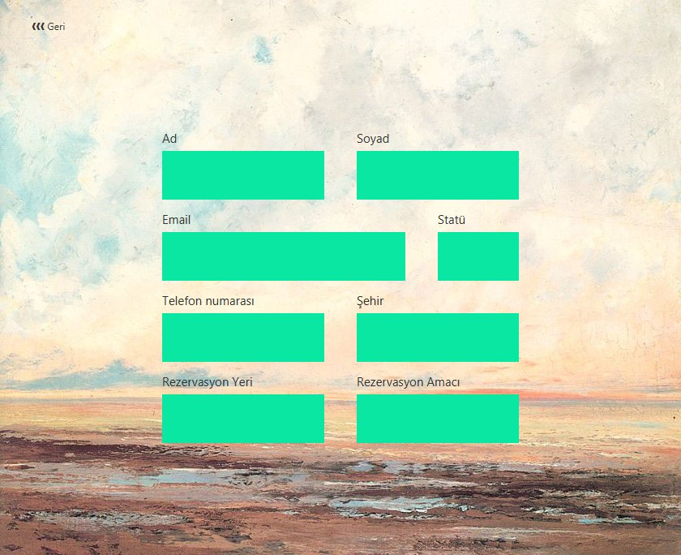
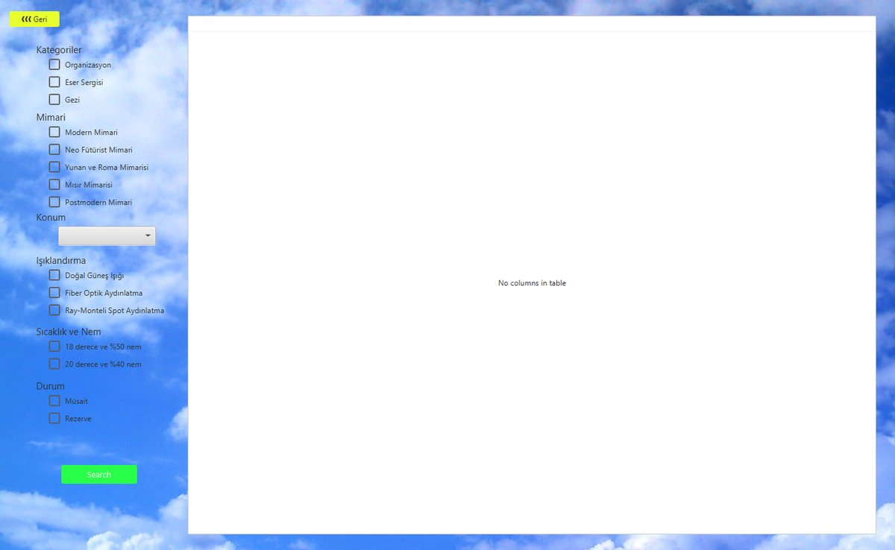
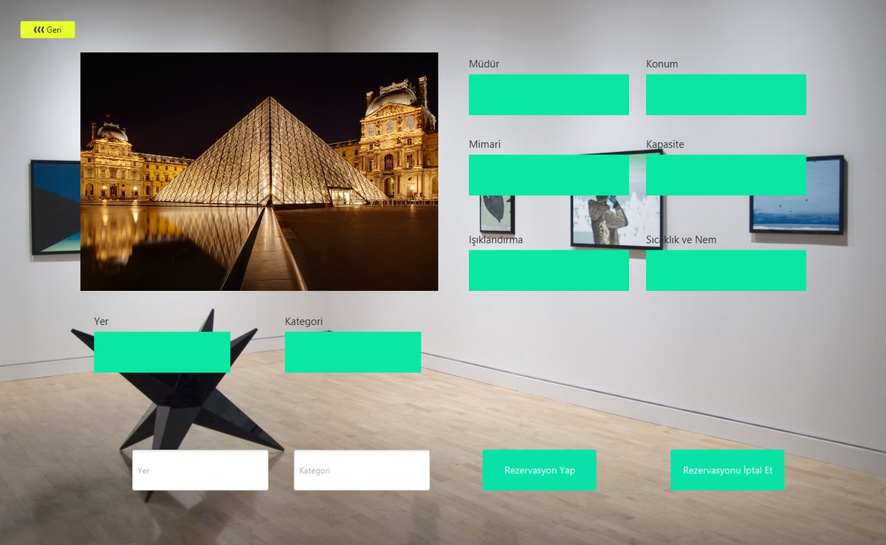

# Müze Kiralama Sistemi

Müze salonlarını etkinlik, sergi ya da gezi için kiralamaya yarayan masaüstü uygulaması. Java, JavaFX ve MySQL ile yazıldı. Kullanıcı kayıt olup giriş yapıyor, salonları kategori, mimari, ışıklandırma ve iklim koşullarına göre filtreliyor, uygun salonu seçip rezervasyon yapıyor.



## Neden?

Bu proje üniversitenin ilk yıllarında, nesne yönelimli programlama ve veritabanı derslerinde öğrenilenleri tek bir uygulamada birleştirmek için yapıldı. Birden fazla ekran arasında geçiş, kullanıcı oturumu, veritabanına kayıt ve dinamik sorgu oluşturma burada ilk kez birlikte denendi.

Uygulamanın en güçlü yanı arama ekranı: alışveriş sitelerindeki kategori filtreleri gibi, seçilen her kutucuk SQL sorgusuna yeni bir koşul olarak ekleniyor ve sonuçlar anında değişiyor.

## Bu neydi?

| | |
|---|---|
| **Tarih** | Mart 2022 |
| **Ne** | Müze salonu kiralama ve rezervasyon sistemi, okul projesi |
| **Teknoloji** | Java 17, JavaFX 17, FXML, JFoenix, MySQL (JDBC), Maven |

## Ekranlar

| Yükleme | Giriş |
|---|---|
|  |  |
| **Kayıt** | **Profil** |
|  |  |
| **Rezervasyon arama** | **Salon detayı ve rezervasyon** |
|  |  |

Ekranlar, veritabanı bağlantısı olmadan FXML dosyalarından çizildi. Bu yüzden arama ekranındaki tablo boş görünüyor.

## Özellikler

- **Kayıt ve giriş:** Kullanıcılar ad, e-posta, telefon ve şehir bilgileriyle kayıt oluyor. Kayıtta girilen referans koduna göre hesap Standart ya da VIP oluyor.
- **Filtreli arama:** Salonlar şu ölçütlere göre aranıyor:
  - **Kategori:** organizasyon, eser sergisi, gezi
  - **Mimari:** modern, neo-fütürist, Yunan ve Roma, Mısır, postmodern
  - **Konum**
  - **Işıklandırma:** doğal güneş ışığı, fiber optik, ray monteli spot
  - **Sıcaklık ve nem**
  - **Durum:** müsait, rezerve

  Seçilen ölçütler tek bir SQL sorgusunda birleştiriliyor.
- **Salon detayı:** Müdür, konum, mimari, kapasite, ışıklandırma, sıcaklık ve nem bilgileri. Rezervasyon yapma ve iptal etme.
- **Profil:** Kullanıcı bilgileri, rezervasyon yeri ve amacı.

## Yapı

| Dosya | Ne yapıyor |
|---|---|
| `src/main/java/.../Müze.java` | Uygulamayı yükleme ekranıyla başlatıyor |
| `Giris_EkranControl.java`, `Kayit_EkranControl.java` | Giriş ve kayıt |
| `Ana_EkranControl.java` | Ana menü ve ekranlar arası geçiş |
| `Rezervasyon_EkranControl.java` | Filtreli arama ve sonuç tablosu |
| `Rezerve_EkranControl.java` | Salon detayı, rezervasyon yapma ve iptal |
| `Profil_EkranControl.java` | Kullanıcı profili |
| `DBConnection.java` | MySQL bağlantısı |
| `src/main/resources/.../*.fxml` | Ekran tasarımları |
| `src/main/resources/com/example/img/` | Arka plan ve simge görselleri |

## Çalıştırma

1. Yerel bir MySQL sunucusunda `uyeler` ve `bilgiler` tablolarının bulunduğu bir veritabanı gerekiyor. Bağlantı ayarları `DBConnection.java` içinde.
2. JFoenix, ControlsFX ve MySQL Connector/J o dönem IDE'ye elle eklenmişti. `pom.xml` içinde bulunmadıkları için çalıştırmadan önce bağımlılık olarak eklenmeleri gerekiyor.
3. Proje Maven ile açılıp JavaFX eklentisiyle çalıştırılıyor:

```bash
mvn javafx:run
```

Bazı arka plan görselleri FXML içinde eski bilgisayardaki tam dosya yoluyla tanımlı. Başka bir makinede bu görsellerin görünmesi için yolların `src/main/resources/com/example/img/` klasörünü gösterecek şekilde güncellenmesi gerekiyor.
